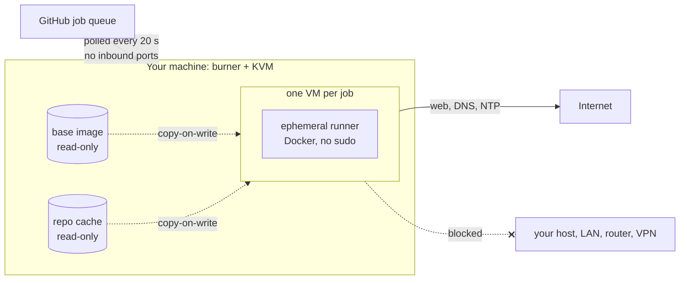

# burner

**Burner VMs for GitHub Actions.**

Every job runs in a fresh Ubuntu VM on your own machine, and the VM is destroyed when the job ends.
Downloads and builds are kept in a **per-repo cache** that pull requests can read but never poison.



## Why

| You want | burner gives you |
|---|---|
| CI minutes that do not come out of your GitHub quota | Runners on hardware you already have |
| Faster jobs than `ubuntu-latest` | A warm cache: Docker layers, packages, toolchains, checkout |
| To run untrusted code (PRs, dependencies) safely | A throwaway VM per job, walled off from your network |
| To see what is going on | A tmux dashboard that needs no sudo |

## How a job flows

1. A job asking for `runs-on: [self-hosted, burner]` shows up in the queue.
2. burner boots a VM from the **base image** plus the **repo cache**.
3. A one-time runner registers, takes the job and exits.
4. If the job was a successful push to a trusted branch, its cache becomes the new repo cache.
5. The VM is destroyed and the runner removed. Always, also on cancel or timeout.

## Quick start

> [!NOTE]
> You need Ubuntu 24.04 with KVM: a physical machine, or a VM with nested virtualization
> ([Hyper-V guide](docs/hyper-v.md)). The full walkthrough is in [docs/install.md](docs/install.md).

Install:

```bash
git clone https://github.com/stonefeld/burner.git
cd burner
sudo ./install.sh
```

Configure your repos:

```bash
sudoedit /etc/burner/burner.toml
```

Set up, build the base image and start:

```bash
sudo burner install
sudo burner check
sudo burner base
sudo burner activate
```

Watch it:

```bash
burner monitor
```

Use it in a workflow:

```yaml
jobs:
  test:
    runs-on: [self-hosted, burner]
```

## Documentation

| Read this | When you want to |
|---|---|
| [Install](docs/install.md) | Set up a host and the GitHub App, step by step |
| [Operations](docs/operations.md) | Pause, resume, rebuild, troubleshoot |
| [Monitoring](docs/monitoring.md) | Use the dashboard and give people read-only access |
| [Workflows](docs/workflows.md) | Adapt your workflows, add a fallback to GitHub |
| [Cache](docs/cache.md) | Understand what is cached and who can write it |
| [Isolation](docs/isolation.md) | Know what is blocked, how it is tested, and the limits |
| [Hyper-V](docs/hyper-v.md) | Run burner on a Windows machine |
| [Decisions](docs/adr/) | Know why it is built this way |

## Limits

- Jobs from **forks** are never run.
- One host, fixed slots. For fleets of machines, look at Actions Runner Controller.
- Linux hosts only. On Windows, run it inside a Hyper-V VM.
- No chat alerts: everything goes to the journal.

## License

[MIT](LICENSE)
