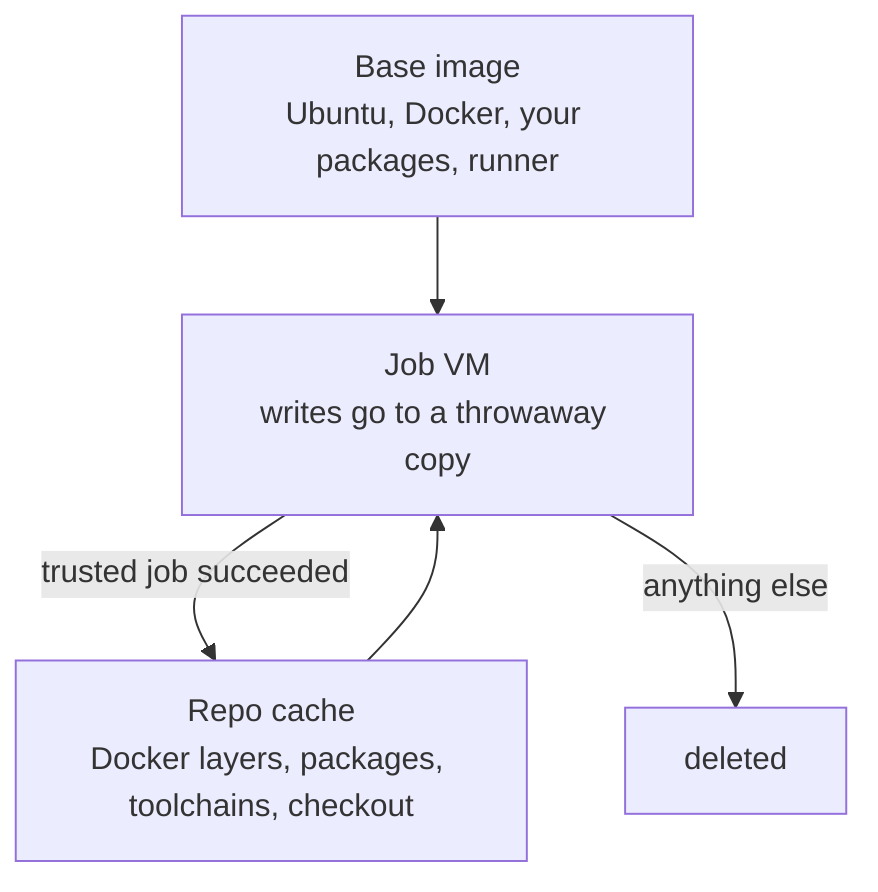

# Cache

**Pull requests read the cache. Only trusted jobs write it.**

## Three layers



| Layer | Holds | Written by | Changes |
|---|---|---|---|
| Base | Ubuntu, Docker, `vm.packages`, runner, `vm.provision` | `burner base` | weekly |
| Repo cache | Docker images and layers, package caches, toolchains, browsers, checkout | trusted jobs only | after each trusted job |
| Job copy | whatever the job writes | the job | deleted at the end |

## What counts as trusted

All of these:

- event is `push`, `schedule` or `workflow_dispatch`;
- branch is in `trusted_branches` (default `main`);
- the run comes from the repo, not a fork;
- the job succeeded;
- if `workflows` is set, the workflow is in it.

In short: code that already passed review. Each repo has its own cache; they never mix.

## What is cached

| Thing | Where it lives in the VM |
|---|---|
| Docker images, layers, build cache | `/var/lib/docker`, `/var/lib/containerd` |
| Checkout and downloaded actions | `/cache/runner/work` |
| uv, pip, pre-commit, go | `/cache/runner/xdg` |
| npm | `/cache/runner/npm` |
| pnpm store | `/cache/runner/pnpm-store` |
| Node / Python / Go from `setup-*` | `/cache/runner/toolcache` |
| Playwright browsers | `/cache/runner/ms-playwright` |

Add your own tools under `[cache.env]`:

```toml
[cache.env]
GRADLE_USER_HOME = "/cache/runner/gradle"
CARGO_HOME = "/cache/runner/cargo"
```

> [!TIP]
> The checkout and the caches share one disk, so uv and pnpm hardlink instead of copying. Reinstalling a
> cached environment takes seconds.

## Size

| Setting | Default | Meaning |
|---|---|---|
| `cache.gib` | 80 | virtual disk size; only written data uses space |
| `cache.max_gib` | 60 | above this, the cache is dropped and starts over |
| `cache.buildkit_gib` | 20 | Docker build cache prunes itself to this |

Start over by hand:

```bash
sudo burner cache-reset owner/repo
```

## Why not a cache proxy on the host

A proxy would mean opening a host port to the VMs, and anyone, including a PR, could write into it.
The per-repo disk opens nothing, and the host never even mounts it. See
[ADR 0002](adr/0002-trusted-per-repo-cache-disk.md).

## Other speed-ups in the base

- Disk writes skip `fsync`: disks are disposable, and the cache is only kept after a clean shutdown.
- No snapd, automatic updates or SSH: faster boot, nothing competing with the job.
- The runner comes pre-installed.
