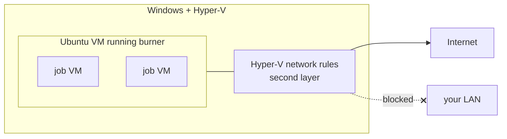

# Hyper-V

Run burner on a Windows machine by putting it inside an Ubuntu VM with **nested virtualization**. The
Hyper-V VM acts as the host, and every job VM runs inside it. Same code, isolation and cache as on a
physical machine.



## Is it fast enough?

| Work | Cost of nesting |
|---|---|
| CPU-heavy (running tests, compiling) | small |
| Many small files and syscalls (`npm install`, `docker build`) | noticeable |
| Booting a job VM | slower, paid once per job |

What usually makes up for it: the warm cache. Measure before deciding:

1. Run your workflow on your current setup.
2. Run it on burner right after a cache reset.
3. Run it again on burner after one trusted run (warm cache).

Compare job durations:

```bash
gh run view <run-id> --json jobs --jq '.jobs[] | [.name, .startedAt, .completedAt]'
```

## 1. Create the VM

All in PowerShell as administrator.

Turn on Hyper-V (reboots):

```powershell
Enable-WindowsOptionalFeature -Online -FeatureName Microsoft-Hyper-V -All
```

Create a private network with NAT, so the VM is not on your LAN:

```powershell
New-VMSwitch -Name burner-nat -SwitchType Internal
$if = Get-NetAdapter -Name 'vEthernet (burner-nat)'
New-NetIPAddress -InterfaceIndex $if.ifIndex -IPAddress 10.99.0.1 -PrefixLength 24
New-NetNat -Name burner-nat -InternalIPInterfaceAddressPrefix 10.99.0.0/24
```

Create the VM with a fixed-size disk (faster than a dynamic one):

```powershell
New-VHD -Path C:\HyperV\burner.vhdx -SizeBytes 200GB -Fixed
New-VM -Name burner -Generation 2 -MemoryStartupBytes 16GB -VHDPath C:\HyperV\burner.vhdx -SwitchName burner-nat
Add-VMDvdDrive burner -Path C:\iso\ubuntu-24.04-live-server-amd64.iso
```

Configure it for nesting:

```powershell
Set-VMMemory burner -DynamicMemoryEnabled $false
Set-VMProcessor burner -Count 8 -ExposeVirtualizationExtensions $true
Set-VMFirmware burner -SecureBootTemplate MicrosoftUEFICertificateAuthority
Set-VM burner -CheckpointType Disabled -AutomaticStartAction Start -AutomaticStopAction ShutDown
Disable-VMIntegrationService burner -Name 'Guest Service Interface'
```

| Setting | Why |
|---|---|
| Static memory | nesting does not work with dynamic memory |
| Expose virtualization | gives the VM `/dev/kvm` |
| Guest Service Interface off | no file copy from Windows into the VM |
| Checkpoints off | the VM is rebuilt, never rolled back |

> [!NOTE]
> Requirements: Intel with VT-x, or AMD with Windows 11 / Server 2022 or newer. The VM must be off to
> expose virtualization.

How much memory to give it:

| Slots | `vm.memory_gib` | VM memory |
|---|---|---|
| 1 | 8 | 14 GB |
| 2 | 8 | 24 GB |
| 2 | 6 | 20 GB |

## 2. Install Ubuntu

From the Hyper-V console, install Ubuntu Server 24.04 with:

| Setting | Value |
|---|---|
| IP | 10.99.0.100/24 |
| Gateway | 10.99.0.1 |
| DNS | 1.1.1.1, 8.8.8.8 |
| OpenSSH | optional, see step 3 |

Inside the VM, check that KVM is there:

```bash
ls -l /dev/kvm
```

```bash
sudo apt-get install -y cpu-checker
kvm-ok
```

Then follow the normal [install](install.md).

> [!TIP]
> If your LAN uses 10.99.x, pick another range. Keep burner's `network.subnet` (10.203.0.0/16 by
> default) different from both.

## 3. Add a second barrier around the VM

The VM holds the GitHub App keys and sits on your network. If a job ever escaped KVM, it would land here,
so let Windows limit the VM too. Rules with a higher weight win, and traffic that matches no rule passes,
so the first two rules close everything.

Close everything:

```powershell
$vm = 'burner'
Add-VMNetworkAdapterExtendedAcl -VMName $vm -Direction Outbound -Action Deny -RemoteIPAddress Any -Weight 1
Add-VMNetworkAdapterExtendedAcl -VMName $vm -Direction Inbound  -Action Deny -RemoteIPAddress Any -Weight 1
```

Allow DNS, web and time:

```powershell
Add-VMNetworkAdapterExtendedAcl -VMName $vm -Direction Outbound -Action Allow -RemoteIPAddress 1.1.1.1 -RemotePort 53 -Protocol UDP -Stateful $true -Weight 10
Add-VMNetworkAdapterExtendedAcl -VMName $vm -Direction Outbound -Action Allow -RemoteIPAddress 8.8.8.8 -RemotePort 53 -Protocol UDP -Stateful $true -Weight 11
Add-VMNetworkAdapterExtendedAcl -VMName $vm -Direction Outbound -Action Allow -RemoteIPAddress Any -RemotePort 443 -Protocol TCP -Stateful $true -Weight 20
Add-VMNetworkAdapterExtendedAcl -VMName $vm -Direction Outbound -Action Allow -RemoteIPAddress Any -RemotePort 80 -Protocol TCP -Stateful $true -Weight 21
Add-VMNetworkAdapterExtendedAcl -VMName $vm -Direction Outbound -Action Allow -RemoteIPAddress Any -RemotePort 123 -Protocol UDP -Stateful $true -Weight 22
```

Block private networks, even on allowed ports:

```powershell
$w = 100
foreach ($r in '10.0.0.0/8','172.16.0.0/12','192.168.0.0/16','169.254.0.0/16','100.64.0.0/10') {
  Add-VMNetworkAdapterExtendedAcl -VMName $vm -Direction Outbound -Action Deny -RemoteIPAddress $r -Weight ($w++)
}
```

Optional: allow SSH, only from the Windows machine itself:

```powershell
Add-VMNetworkAdapterExtendedAcl -VMName $vm -Direction Inbound -Action Allow -RemoteIPAddress 10.99.0.1 -LocalPort 22 -Protocol TCP -Stateful $true -Weight 200
```

Review the rules:

```powershell
Get-VMNetworkAdapterExtendedAcl -VMName $vm | sort Direction, Weight -Descending |
  ft Direction, Weight, Action, RemoteIPAddress, RemotePort, LocalPort, Protocol, Stateful
```

> [!NOTE]
> The VM still reaches the internet through 10.99.0.1, even though 10.0.0.0/8 is blocked: the rule looks at
> the final destination, which is public.

Keep the VM clean: only burner, no shared folders, no Docker on it.

## 4. Watch it from Windows

A number no job can fake: the VM's total traffic.

```powershell
Enable-VMResourceMetering -VMName burner
```

```powershell
Measure-VM burner
```

## Fallback: one persistent runner VM

If nesting is not possible, a single long-lived VM with a regular runner also works, behind the same rules
from step 3 (without the SSH rule).

> [!WARNING]
> Every job shares the same disk, so **any job writes the cache**. A malicious pull request can leave
> something behind for the next job, including the one on `main`. Use this only if everyone who can open
> pull requests is trusted.

### Prepare the VM

Install Docker Engine from docker.com, then limit its logs and build cache:

```bash
echo '{"log-driver":"json-file","log-opts":{"max-size":"10m","max-file":"3"},"builder":{"gc":{"enabled":true,"defaultKeepStorage":"20GB"}}}' | sudo tee /etc/docker/daemon.json
sudo systemctl restart docker
```

Clean up weekly, since nothing starts fresh here:

```bash
echo '0 4 * * 0 root docker system prune -af --filter until=72h && docker volume prune -af' | sudo tee /etc/cron.d/ci-cleanup
```

### Install the runner

Create the user:

```bash
sudo adduser --disabled-password --comment "" runner
sudo usermod -aG docker runner
```

Download the runner. Take the URL and hash from **Settings → Actions → Runners → New self-hosted runner**:

```bash
sudo -iu runner
mkdir actions-runner && cd actions-runner
curl -o runner.tar.gz -L <url>
echo "<hash>  runner.tar.gz" | sha256sum -c
tar xzf runner.tar.gz
exit
```

Install its dependencies:

```bash
sudo /home/runner/actions-runner/bin/installdependencies.sh
```

Register it. The token is on the same page and lasts one hour:

```bash
sudo -iu runner
cd actions-runner
./config.sh --url https://github.com/<owner>/<repo> --token <token> --name ci-windows --labels burner --unattended
exit
```

Run it as a service:

```bash
cd /home/runner/actions-runner
sudo ./svc.sh install runner
sudo ./svc.sh start
```

### Fallback to GitHub

A persistent runner shows as online in the API, so the `pick` job can ask GitHub directly:

1. Create a fine-grained token with **Administration: Read-only** on the repo.
2. Save it as the secret `RUNNERS_TOKEN`:

   ```bash
   gh secret set RUNNERS_TOKEN
   ```

3. Use this step in the `pick` job of the [workflows guide](workflows.md#fall-back-to-github-when-the-host-is-off):

   ```yaml
   - id: r
     env:
       GH_TOKEN: ${{ secrets.RUNNERS_TOKEN }}
       DEPENDABOT: ${{ github.actor == 'dependabot[bot]' }}
     run: |
       online=0
       if [ "$DEPENDABOT" = false ] && [ -n "$GH_TOKEN" ]; then
         online=$(gh api "repos/$GITHUB_REPOSITORY/actions/runners" \
           --jq '[.runners[] | select(.status == "online" and any(.labels[]; .name == "burner"))] | length' || echo 0)
       fi
       if [ "$online" -gt 0 ]; then echo 'runner=["self-hosted","burner"]'; else echo 'runner="ubuntu-latest"'; fi | tee -a "$GITHUB_OUTPUT"
   ```

> [!IMPORTANT]
> Write down when the token expires. Once it does, every job quietly goes back to GitHub.

### Test the isolation

Inside the VM, as `runner`. Each line must print `ok`:

```bash
for t in 10.99.0.1:445 10.99.0.1:3389 <pc-ip>:445 <router-ip>:80 <router-ip>:443 <lan-server>:22 1.1.1.1:22; do
  r=$(nc -zv -w3 ${t%:*} ${t#*:} 2>&1)
  case "$r" in *succeeded*|*refused*) echo "BAD  $t → $r";; *) echo "ok   $t";; esac
done
```

This must time out:

```bash
dig @9.9.9.9 github.com +time=2 +tries=1
```
