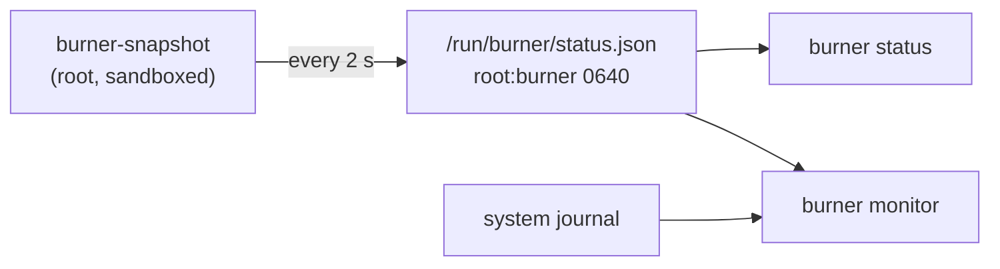

# Monitoring

Watching burner never needs sudo.

## Give someone access

Once per person:

```bash
sudo usermod -aG burner,systemd-journal alice
```

Alice logs out and back in, then:

```bash
burner monitor
```

| Group | Lets them |
|---|---|
| `burner` | read the status snapshot |
| `systemd-journal` | read logs and blocked packets |

> [!NOTE]
> Actions (`pause`, `activate`, `base`, `selftest`, `cache-reset`, `exec`) still need root.

To let someone pause and resume without a password, create a sudoers rule:

```bash
sudo visudo -f /etc/sudoers.d/burner
```

```text
alice ALL=(root) NOPASSWD: /usr/local/bin/burner pause, /usr/local/bin/burner activate
```

## The dashboard

```bash
burner monitor
```

It opens a tmux session called `burner`, or reattaches to it.

| Window | Shows |
|---|---|
| 1 overview | host, base, slots (CPU, RAM, traffic per VM), caches · network policy and drop counters |
| 2 resources | btop |
| 3 jobs | controller log · packets blocked by the firewall |

| Keys | Action |
|---|---|
| `Ctrl-b 1` … `3` | switch window |
| `Ctrl-b z` | zoom a pane |
| `Ctrl-b d` | leave it running |
| mouse | click and scroll work |

Rebuild the session from scratch:

```bash
burner monitor --reset
```

One-shot views, without tmux:

```bash
burner status
```

```bash
burner status --network
```

```bash
burner status --json
```

## Reading it

| You see | It means |
|---|---|
| Snapshot age in red | the status service is down, see [operations](operations.md#the-snapshot-is-old) |
| `Filter MISMATCH` | the firewall was changed; no VM will start until it is reloaded |
| Drop counters growing during a job | that job tried to reach something it should not |
| OUT/s much higher than usual | worth checking which job and which PR |

> [!IMPORTANT]
> A green dashboard does not prove isolation. Only the [self-test](isolation.md#the-self-test) does. Nothing on the dashboard
> comes from inside a VM, because a VM can lie about itself.

## How it works



- The root service reads what only root can read (firewall counters, slot state) and writes a small
  JSON file.
- Your dashboard only reads that file and the journal.
- Traffic per VM comes from the host's network counters, so tools like nethogs (which need sudo) are not
  used.
- The file holds no tokens, keys or job logs. It does hold your public IP, which is why only the group can
  read it.
